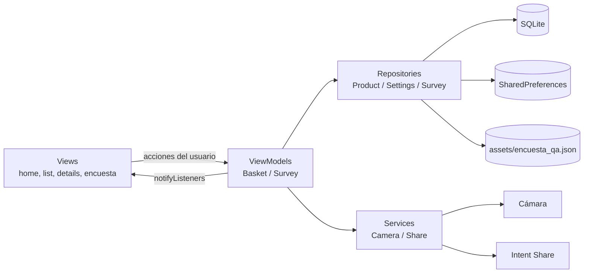
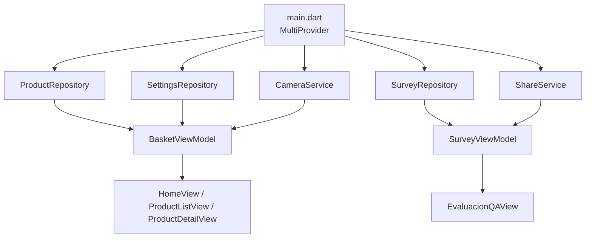

# Food Calculator

Calculadora de canasta básica desarrollada para la iniciativa **Workspace Mobile Firsts** de Lircayhub.
<<<<<<< Updated upstream
El usuario ingresa su sueldo o presupuesto y la app genera una canasta de alimentos balanceada por categorías, que puede ajustar manualmente.

**Autor:** [Tu nombre] · **Curso:** Programación de Dispositivos Móviles 2026-02 · Universidad de Talca
**Entrega:** Producto de Software 2 (Prototipo Funcional y Servicios del Móvil)
=======

La aplicación permite al usuario ingresar su sueldo o presupuesto disponible y genera automáticamente una canasta de alimentos balanceada, distribuida por categorías. Además, permite modificar manualmente los productos y sus cantidades según las necesidades del usuario.

**Autor:** Benjamin Llauca Espinoza  
**Curso:** Programación de Dispositivos Móviles 2026-02  
**Universidad:** Universidad de Talca  
**Entrega:** Producto de Software 2 - Prototipo Funcional y Servicios del Móvil
>>>>>>> Stashed changes

---

## Recursos

| Recurso | Enlace |
|---|---|
<<<<<<< Updated upstream
| APK (Android) | [GitHub Release v1.0.0-beta](ENLACE_AL_RELEASE) |
| Diapositivas del Pitch | [Ver presentación](ENLACE_SLIDES) |
| Video Pitch (máx. 5 min) | [Ver video](ENLACE_VIDEO) |

---

## Funcionalidades

- Generación automática de canasta según presupuesto, con cuotas por categoría.
- Armado manual de la canasta (agregar, quitar, editar y eliminar productos).
- Fotografía de productos con la cámara del dispositivo.
- Detalle de producto sincronizado con la lista.
- Persistencia del último sueldo, productos y cantidades entre sesiones.
- Módulo de evaluación QA integrado (instrumento JSON y envío por Intent nativo).

---

## Arquitectura MVVM

La app sigue el patrón **Model-View-ViewModel** con **Provider + ChangeNotifier** como gestor de estado.



### Responsabilidades por capa

| Capa | Carpeta | Responsabilidad |
|---|---|---|
| Model | `lib/models/` | Entidades del dominio (`ProductModel`). |
| View | `lib/views/` | Solo interfaz. Observa el ViewModel y delega las acciones. Sin acceso a datos ni lógica de negocio. |
| ViewModel | `lib/viewmodels/` | Estado y lógica de negocio: algoritmo de canasta, saldo, CRUD, validaciones y reporte de QA. |
| Repository | `lib/repositories/` | Único punto de acceso a SQLite, SharedPreferences y assets. |
| Service | `lib/services/` | Capacidades del dispositivo: cámara y compartir. |
| Data | `lib/data/` | `DatabaseHelper` (SQLite). |

### Inyección de dependencias

`main.dart` es la raíz de composición: un `MultiProvider` crea repositorios y servicios y los entrega por constructor a los ViewModels.



Ventajas: cada capa puede reemplazarse o probarse de forma aislada, y las vistas se actualizan solas cuando el ViewModel notifica cambios (maestro y detalle consistentes).

### Estructura del proyecto

```
lib/
 ├─ main.dart
 ├─ theme/app_theme.dart
 ├─ models/product.dart
 ├─ data/database_helper.dart
 ├─ repositories/   product_repository, settings_repository, survey_repository
 ├─ services/       camera_service, share_service
 ├─ viewmodels/     basket_viewmodel, survey_viewmodel
 └─ views/          home, list, details, encuesta, widgets/
=======
| Repositorio | [GitHub - Food Calculator](https://github.com/EternalLamb/Food_calculator) |
| APK Android | [Descargar aplicación]    (https://drive.google.com/file/d/1hJq3X_Uv4MJtK95aNX__lx952FvFz_dw/view?usp=sharing) |
| Presentación Pitch |                    https://docs.google.com/presentation/d/1hxej4aW1Pp0-0288Z8kE4Gss1UWGO7Wy/edit?usp=sharing&ouid=106514722458000406157&rtpof=true&sd=true
| Video Pitch | ENLACE_VIDEO |              https://drive.google.com/file/d/1b1EeNfeJBnm76jirOxtCtN_m9SKEobAy/view?usp=sharing


---

## Funcionalidades principales

- **Generación automática de canasta:** crea una selección de productos según el presupuesto ingresado, distribuyendo los recursos mediante cuotas por categoría.
- **Gestión manual de productos:** permite agregar, editar, modificar cantidades y eliminar productos de la canasta.
- **Captura de fotografías:** permite tomar fotografías de los productos utilizando la cámara del dispositivo.
- **Detalle de productos:** mantiene sincronizada la información de cada producto con la lista de compras.
- **Persistencia de datos:** conserva el último sueldo ingresado, los productos y sus cantidades entre sesiones.
- **Evaluación QA integrada:** incluye un instrumento de evaluación en formato JSON y permite enviar los resultados mediante un Intent nativo de Android.

---

## Arquitectura del proyecto

La aplicación utiliza el patrón arquitectónico **MVVM (Model-View-ViewModel)**, implementado mediante Provider y ChangeNotifier para la gestión del estado.

Esta arquitectura permite separar la interfaz gráfica, la lógica de negocio y el acceso a los datos, facilitando el mantenimiento, la organización y las pruebas del software.

### Responsabilidades de cada capa

| Capa          | Directorio            | Responsabilidad |
|---            |---                    |---|
| Model         | `lib/models/`         | Define las entidades del dominio, como `ProductModel`. |
| View          | `lib/views/`          | Contiene las interfaces gráficas. Observa el ViewModel y delega las acciones del usuario. |
| ViewModel     | `lib/viewmodels/`     | Gestiona el estado y la lógica de negocio: generación de canastas, saldo, operaciones CRUD, validaciones y reportes QA. |
| Repository    | `lib/repositories/`   | Centraliza el acceso a SQLite, SharedPreferences y los recursos de la aplicación. |
| Service       | `lib/services/`       | Encapsula las funcionalidades del dispositivo, como la cámara y el uso compartido de información. |
| Data          | `lib/data/`           | Contiene `DatabaseHelper`, encargado de gestionar la base de datos SQLite. |

### Inyección de dependencias

La inyección de dependencias se realiza desde `main.dart`, que funciona como raíz de composición de la aplicación.

Mediante `MultiProvider` se crean las instancias de los repositorios y servicios, que posteriormente se entregan a los ViewModels mediante sus constructores.

De esta manera, cada componente recibe las dependencias que necesita sin tener que construirlas directamente, reduciendo el acoplamiento entre las distintas capas.

### Estructura del proyecto

```text
lib/
├── main.dart
├── theme/
│   └── app_theme.dart
├── models/
│   └── product.dart
├── data/
│   └── database_helper.dart
├── repositories/
│   ├── product_repository.dart
│   ├── settings_repository.dart
│   └── survey_repository.dart
├── services/
│   ├── camera_service.dart
│   └── share_service.dart
├── viewmodels/
│   ├── basket_viewmodel.dart
│   └── survey_viewmodel.dart
└── views/
    ├── home/
    ├── list/
    ├── details/
    ├── encuesta/
    └── widgets/
>>>>>>> Stashed changes
```

---

<<<<<<< Updated upstream
## ADR: Prueba de Concepto (cámara y persistencia)

- **Contexto:** los riesgos técnicos identificados fueron usar la cámara del dispositivo y conservar datos de forma confiable entre sesiones.
- **Decisión:**
  - `image_picker` encapsulado en `CameraService`, con `Future`, manejo de permiso denegado, error de plataforma y cancelación.
  - `sqflite` para productos y cantidades, y `shared_preferences` para el último sueldo, ambos detrás de repositorios.
  - `share_plus` encapsulado en `ShareService` para la interoperabilidad con el sistema.
- **Alternativas descartadas:** [por ejemplo: Firebase (requiere red y cuenta), Hive (menos estándar para el curso)]. *Ajusta según tu ADR de la DP2.*
- **Consecuencias:**
  - (+) Desacoplamiento, errores controlados y capas fáciles de probar.
  - (−) Dependencia del permiso de cámara y del almacenamiento local, sin sincronización en la nube.
- **Conclusión:** la PoC original era una pantalla descartable con errores. No se hizo merge directo: se refactorizó en una capa de servicios y repositorios consumida únicamente a través del ViewModel.

---

## Persistencia

| Dato | Mecanismo | Acceso |
|---|---|---|
| Productos, categorías, cantidades e imágenes | SQLite (`sqflite`) | `ProductRepository` |
| Último sueldo ingresado | `shared_preferences` | `SettingsRepository` |

Al reabrir la app, el sueldo aparece pre-llenado y la canasta conserva sus cantidades.
=======
## ADR: Prueba de Concepto (PoC)

Durante el desarrollo se identificaron dos riesgos técnicos principales: la integración con la cámara del dispositivo y la persistencia confiable de los datos entre sesiones.

### Decisiones técnicas

- **Cámara:** se seleccionó `image_picker`, encapsulado dentro de `CameraService`. Se implementó el manejo de permisos denegados, errores de plataforma y cancelación de la captura.
- **Persistencia de productos:** se seleccionó `sqflite` para almacenar los productos y sus cantidades en una base de datos SQLite local.
- **Configuración:** se seleccionó `shared_preferences` para conservar el último sueldo ingresado.
- **Interoperabilidad:** se seleccionó `share_plus`, encapsulado dentro de `ShareService`, para compartir información mediante las opciones nativas del sistema.

### Alternativas descartadas

- **Firebase:** se descartó debido a que requiere conexión a internet y configuración de una cuenta o proyecto externo, lo que añade complejidad innecesaria para una solución local.
- **Hive:** se consideró como alternativa de almacenamiento local, pero se prefirió SQLite por su modelo relacional, consultas estructuradas y adecuación al manejo de productos y cantidades.

### Consecuencias de las decisiones

**Ventajas:**
- Mayor desacoplamiento entre las funcionalidades.
- Manejo controlado de errores y permisos.
- Separación del acceso a datos mediante repositorios.
- Mayor facilidad para realizar pruebas y mantener el código.

**Desventajas:**
- Dependencia de los permisos del dispositivo para utilizar la cámara.
- Almacenamiento exclusivamente local.
- Ausencia de sincronización en la nube entre dispositivos.

### Conclusión de la PoC

La prueba de concepto inicial consistía en una pantalla independiente y descartable que permitía comprobar las funcionalidades técnicas, pero presentaba limitaciones en su integración con la arquitectura final.

En lugar de realizar un merge directo, se refactorizaron las funcionalidades y se incorporaron mediante servicios y repositorios, permitiendo que los ViewModels fueran el único punto de interacción con estas dependencias.

---

## Persistencia de datos

La aplicación utiliza dos mecanismos de almacenamiento local, seleccionados según el tipo de información que necesitan conservar.

| Información | Mecanismo | Acceso |
|---|---|---|
| Productos, categorías, cantidades e imágenes | SQLite (`sqflite`) | `ProductRepository` |
| Último sueldo ingresado | SharedPreferences | `SettingsRepository` |

Al iniciar nuevamente la aplicación, el último sueldo ingresado aparece precargado y la canasta conserva los productos y sus respectivas cantidades.
>>>>>>> Stashed changes

---

## Interoperabilidad e identidad nativa

<<<<<<< Updated upstream
- **Intent nativo:** el reporte de QA se comparte con el selector del sistema (`share_plus`). Declaraciones `<queries>` agregadas al `AndroidManifest.xml` para correo y enlaces.
- **Cámara:** permiso `CAMERA` declarado y solicitado en tiempo de ejecución.
- **Package name:** [`cl.utalca.foodcalculator` — reemplaza por el tuyo] bajo estándar de dominio inverso.
- **Ícono de la app y Splash Screen:** [indica brevemente lo que configuraste].
=======
La aplicación integra funcionalidades nativas de Android para interactuar con las capacidades del dispositivo y otros servicios del sistema.

### Intent nativo

El reporte de QA puede compartirse mediante el selector nativo de Android utilizando `share_plus`.

Además, se agregaron las declaraciones `<queries>` correspondientes en `AndroidManifest.xml` para permitir la interoperabilidad con aplicaciones de correo y enlaces.

### Cámara

Se declaró el permiso `CAMERA` en el archivo `AndroidManifest.xml` y se implementó su solicitud durante la ejecución de la aplicación.

La funcionalidad está encapsulada en `CameraService`, evitando que la interfaz gráfica gestione directamente los permisos y las operaciones de cámara.

### Identidad de la aplicación

- **Package name:** `cl.utalca.foodcalculator`.
- **Ícono de aplicación:** PENDIENTE DE DOCUMENTAR.
- **Splash Screen:** PENDIENTE DE DOCUMENTAR.
>>>>>>> Stashed changes

---

## Reporte de QA (Beta Testing)

<<<<<<< Updated upstream
**Instrumento:** 6 preguntas en `assets/encuesta_qa.json` (3 de cumplimiento de HU, 2 de usabilidad y 1 de valoración general), respondidas de 1 a 5 estrellas dentro de la app y enviadas por Intent nativo. La versión actual agrega una pregunta de valoración (VAL-02), un selector de perfil y un campo de comentarios. La beta se ejecutó con la versión de 6 preguntas.

**Muestra:** 10 usuarios: 4 participantes de Workspace Mobile Firsts, 3 conocedores de la industria y 3 externos. Evidencia en [`docs/qa_evidencia/`](docs/qa_evidencia/).

| Perfil | Usuarios | Promedio |
|---|---|---|
| Participantes de la iniciativa | 4 | 4,50 |
| Conocedores de la industria | 3 | 4,89 |
| Externos a la industria | 3 | 5,00 |
| **Global** | **10** | **4,77** |

| Pregunta | Promedio |
|---|---|
| HU-01 Generar canasta automática | 4,7 |
| HU-02 Agregar, editar y eliminar productos | 4,9 |
| HU-03 Cámara | 4,7 |
| UX-01 Navegación y claridad visual | 4,7 |
| UX-02 Persistencia de datos | 4,8 |
| VAL-01 Utilidad y expectativas | 4,8 |

### Qué funcionó

- La gestión de productos obtuvo la mejor nota (4,9).
- La persistencia fue bien valorada (4,8). Un usuario destacó que los productos y las imágenes agregados se mantuvieron entre sesiones.
- La utilidad general cumplió expectativas (4,8).
- La cámara funcionó sin problemas para 9 de 10 usuarios.

### Qué falló

- **Generación automática (HU-01):** un participante la calificó con 2/5. Otro usuario señaló que no es claro con qué criterios la canasta automática elige productos.
- **Flujo de la canasta:** no existe un botón para finalizar o confirmar la canasta, y se mezcla la pantalla donde se agregan productos con la canasta ya armada.
- **Productos por defecto:** pueden eliminarse sin forma de recuperarlos.
- **Puntajes de 3/5:** navegación y persistencia (un participante) y cámara (un usuario de la industria). No se registró la causa.
- **Limitación del estudio:** 8 de 10 reportes puntuaron casi todo con 5/5, por lo que puede existir sesgo de cortesía. Solo un usuario entregó comentarios escritos, por lo que los hallazgos cualitativos son limitados.

### Deuda técnica y trabajos futuros

- Pantalla de confirmación o resumen de la canasta, separando "armar" de "ver".
- Ventana de ayuda que explique el criterio del algoritmo (cuotas por categoría y priorización de productos más baratos).
- Botón para restaurar los productos por defecto.
- Guardar varias listas de compras y reutilizarlas, y compartirlas con otras personas.
- Generalizar la app a otros tipos de compra (herramientas, ropa, juguetes).
- Categoría "Limpieza" sin productos base.
- Precios estáticos: integrar una API de precios.
- Pruebas unitarias de los ViewModels.
- QA: comentario obligatorio y perfil incluido en el reporte, para mejorar el análisis cualitativo.
- Sin soporte iOS verificado ni sincronización en la nube.
=======
Se realizó una evaluación beta para medir el cumplimiento de los requerimientos funcionales, la usabilidad y la percepción general de la aplicación.

### Instrumento de evaluación

Se desarrolló un instrumento de evaluación compuesto inicialmente por 6 preguntas, almacenadas en `assets/encuesta_qa.json`.

Las preguntas se distribuyeron de la siguiente manera:

- 3 preguntas relacionadas con el cumplimiento de las historias de usuario.
- 2 preguntas relacionadas con la experiencia de usuario y usabilidad.
- 1 pregunta de valoración general.

Las respuestas se registraron mediante una escala de 1 a 5 estrellas dentro de la aplicación y posteriormente se enviaron mediante un Intent nativo.

La versión actual del instrumento incorpora una pregunta adicional de valoración (VAL-02), un selector de perfil y un campo de comentarios. Sin embargo, la beta analizada se realizó utilizando la versión original de 6 preguntas.

### Muestra de participantes

La evaluación contó con 10 participantes, distribuidos en tres perfiles:

| Perfil | Participantes | Promedio |
|---|---:|---:|
| Participantes de la iniciativa | 4 | 4,50 |
| Conocedores de la industria | 3 | 4,89 |
| Externos a la industria | 3 | 5,00 |
| **Promedio global** | **10** | **4,77** |

### Resultados por pregunta

| Pregunta | Promedio |
|---|---:|
| HU-01 - Generar canasta automática | 4,7 |
| HU-02 - Agregar, editar y eliminar productos | 4,9 |
| HU-03 - Cámara | 4,7 |
| UX-01 - Navegación y claridad visual | 4,7 |
| UX-02 - Persistencia de datos | 4,8 |
| VAL-01 - Utilidad y expectativas | 4,8 |

### Aspectos que funcionaron correctamente

- La gestión de productos obtuvo la mejor valoración, con un promedio de 4,9.
- La persistencia de datos fue bien evaluada, alcanzando un promedio de 4,8. Un participante destacó que los productos y las imágenes agregadas se mantuvieron correctamente entre sesiones.
- La utilidad general de la aplicación cumplió las expectativas de los participantes, obteniendo un 4,8.
- La funcionalidad de cámara funcionó correctamente para 9 de los 10 participantes.

### Problemas identificados

- **Generación automática de canasta (HU-01):** un participante calificó esta funcionalidad con 2/5. Otro indicó que no queda claro qué criterios utiliza el algoritmo para seleccionar los productos.
- **Flujo de la canasta:** no existe un botón para finalizar o confirmar la canasta. Además, se mezclan las pantallas destinadas a agregar productos con aquellas que muestran la canasta ya construida.
- **Productos predeterminados:** actualmente pueden eliminarse sin disponer de una opción para restaurarlos.
- **Puntajes intermedios:** se registraron evaluaciones de 3/5 en navegación, persistencia y cámara. No se obtuvieron comentarios que permitieran identificar las causas específicas.
- **Limitaciones de la evaluación:** 8 de los 10 participantes calificaron casi todas las preguntas con 5/5, lo que podría indicar un sesgo de cortesía. Además, solamente un participante entregó comentarios escritos, limitando el análisis cualitativo.

### Deuda técnica y trabajos futuros

A partir de los resultados del beta testing se identificaron las siguientes mejoras:

1. Implementar una pantalla de confirmación o resumen de la canasta, separando el proceso de armado de la visualización final.
2. Incorporar una ventana de ayuda que explique los criterios del algoritmo de generación automática, incluyendo las cuotas por categoría y la priorización de productos más económicos.
3. Agregar un botón para restaurar los productos predeterminados.
4. Permitir guardar múltiples listas de compras, reutilizarlas y compartirlas con otras personas.
5. Generalizar la aplicación para administrar otros tipos de compras, como herramientas, ropa y juguetes.
6. Incorporar productos predeterminados para la categoría de limpieza.
7. Reemplazar los precios estáticos mediante la integración de una API de precios.
8. Implementar pruebas unitarias para los ViewModels.
9. Mejorar el instrumento de QA, incorporando comentarios obligatorios y el perfil del participante para facilitar el análisis cualitativo.
10. Evaluar la compatibilidad con iOS y desarrollar mecanismos de sincronización en la nube.
>>>>>>> Stashed changes

---

## Control de versiones

<<<<<<< Updated upstream
- Ramas `feature/*` por cada funcionalidad: `limpieza-inicial`, `repositories`, `services`, `basket-viewmodel`, `di-home`, `views-refactor`, `qa-survey`.
- `.gitignore` excluye `build/` y archivos autogenerados.
- El instalable se publica en **GitHub Releases** con el tag `v1.0.0-beta`.
=======
El desarrollo se organizó mediante Git y GitHub, utilizando ramas independientes para implementar y mantener las distintas funcionalidades.

Entre las ramas utilizadas se encuentran:

- `feature/limpieza-inicial`
- `feature/repositories`
- `feature/services`
- `feature/basket-viewmodel`
- `feature/di-home`
- `feature/views-refactor`
- `feature/qa-survey`

Se configuró `.gitignore` para excluir directorios de compilación (`build/`) y archivos autogenerados que no necesitan formar parte del repositorio.

El instalable de Android se publica mediante **GitHub Releases**, utilizando la etiqueta de versión `v1.0.0-beta`.
>>>>>>> Stashed changes

---

## Instalación

<<<<<<< Updated upstream
**Usuarios (Android):**
1. Descarga el APK desde [Releases](ENLACE_AL_RELEASE).
2. Habilita "instalar apps de orígenes desconocidos".
3. Instala y abre Food Calculator.

**Desarrollo:**
```bash
flutter pub get
flutter run
```
=======
### Usuarios de Android

1. Descargar el APK desde el enlace de distribución.
2. Habilitar la instalación de aplicaciones provenientes de fuentes desconocidas, si Android lo solicita.
3. Instalar la aplicación.
4. Abrir Food Calculator y comenzar a utilizarla.

### Desarrollo

Para ejecutar el proyecto localmente, es necesario tener instalado Flutter y contar con un dispositivo Android o emulador configurado.

Clonar el repositorio:

```bash
git clone https://github.com/EternalLamb/Food_calculator.git
```

Ingresar al directorio:

```bash
cd Food_calculator
```

Instalar las dependencias:

```bash
flutter pub get
```

Ejecutar la aplicación:

```bash
flutter run
```

---

**Food Calculator - Universidad de Talca, 2026.**
>>>>>>> Stashed changes
