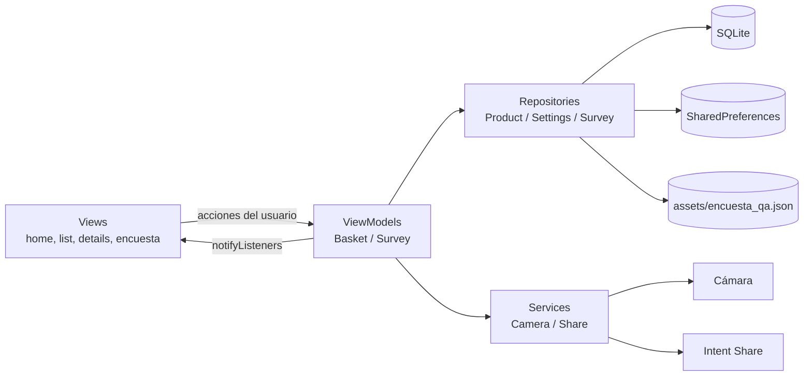
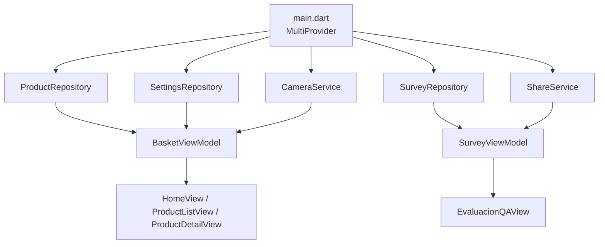

# Food Calculator

Calculadora de canasta básica desarrollada para la iniciativa **Workspace Mobile Firsts** de Lircayhub.
El usuario ingresa su sueldo o presupuesto y la app genera una canasta de alimentos balanceada por categorías, que puede ajustar manualmente.

**Autor:** [Tu nombre] · **Curso:** Programación de Dispositivos Móviles 2026-02 · Universidad de Talca
**Entrega:** Producto de Software 2 (Prototipo Funcional y Servicios del Móvil)

---

## Recursos

| Recurso | Enlace |
|---|---|
| APK (Android) | [GitHub Release v1.0.0-beta](ENLACE_AL_RELEASE) |
| Diapositivas del Pitch | [Ver presentación](ENLACE_SLIDES) |
| Video Pitch (máx. 5 min) | [Ver video](ENLACE_VIDEO) |

---

## Funcionalidades

- Generación automática de canasta según presupuesto, con cuotas por categoría.
- Armado manual de la canasta (agregar, quitar, editar y eliminar productos).
- Fotografía de productos con la cámara del dispositivo.
- Detalle de producto sincronizado con la lista.
- Persistencia del último sueldo, productos y cantidades entre sesiones.
- Módulo de evaluación QA integrado (instrumento JSON y envío por Intent nativo).

---

## Arquitectura MVVM

La app sigue el patrón **Model-View-ViewModel** con **Provider + ChangeNotifier** como gestor de estado.



### Responsabilidades por capa

| Capa | Carpeta | Responsabilidad |
|---|---|---|
| Model | `lib/models/` | Entidades del dominio (`ProductModel`). |
| View | `lib/views/` | Solo interfaz. Observa el ViewModel y delega las acciones. Sin acceso a datos ni lógica de negocio. |
| ViewModel | `lib/viewmodels/` | Estado y lógica de negocio: algoritmo de canasta, saldo, CRUD, validaciones y reporte de QA. |
| Repository | `lib/repositories/` | Único punto de acceso a SQLite, SharedPreferences y assets. |
| Service | `lib/services/` | Capacidades del dispositivo: cámara y compartir. |
| Data | `lib/data/` | `DatabaseHelper` (SQLite). |

### Inyección de dependencias

`main.dart` es la raíz de composición: un `MultiProvider` crea repositorios y servicios y los entrega por constructor a los ViewModels.



Ventajas: cada capa puede reemplazarse o probarse de forma aislada, y las vistas se actualizan solas cuando el ViewModel notifica cambios (maestro y detalle consistentes).

### Estructura del proyecto

```
lib/
 ├─ main.dart
 ├─ theme/app_theme.dart
 ├─ models/product.dart
 ├─ data/database_helper.dart
 ├─ repositories/   product_repository, settings_repository, survey_repository
 ├─ services/       camera_service, share_service
 ├─ viewmodels/     basket_viewmodel, survey_viewmodel
 └─ views/          home, list, details, encuesta, widgets/
```

---

## ADR: Prueba de Concepto (cámara y persistencia)

- **Contexto:** los riesgos técnicos identificados fueron usar la cámara del dispositivo y conservar datos de forma confiable entre sesiones.
- **Decisión:**
  - `image_picker` encapsulado en `CameraService`, con `Future`, manejo de permiso denegado, error de plataforma y cancelación.
  - `sqflite` para productos y cantidades, y `shared_preferences` para el último sueldo, ambos detrás de repositorios.
  - `share_plus` encapsulado en `ShareService` para la interoperabilidad con el sistema.
- **Alternativas descartadas:** [por ejemplo: Firebase (requiere red y cuenta), Hive (menos estándar para el curso)]. *Ajusta según tu ADR de la DP2.*
- **Consecuencias:**
  - (+) Desacoplamiento, errores controlados y capas fáciles de probar.
  - (−) Dependencia del permiso de cámara y del almacenamiento local, sin sincronización en la nube.
- **Conclusión:** la PoC original era una pantalla descartable con errores. No se hizo merge directo: se refactorizó en una capa de servicios y repositorios consumida únicamente a través del ViewModel.

---

## Persistencia

| Dato | Mecanismo | Acceso |
|---|---|---|
| Productos, categorías, cantidades e imágenes | SQLite (`sqflite`) | `ProductRepository` |
| Último sueldo ingresado | `shared_preferences` | `SettingsRepository` |

Al reabrir la app, el sueldo aparece pre-llenado y la canasta conserva sus cantidades.

---

## Interoperabilidad e identidad nativa

- **Intent nativo:** el reporte de QA se comparte con el selector del sistema (`share_plus`). Declaraciones `<queries>` agregadas al `AndroidManifest.xml` para correo y enlaces.
- **Cámara:** permiso `CAMERA` declarado y solicitado en tiempo de ejecución.
- **Package name:** [`cl.utalca.foodcalculator` — reemplaza por el tuyo] bajo estándar de dominio inverso.
- **Ícono de la app y Splash Screen:** [indica brevemente lo que configuraste].

---

## Reporte de QA (Beta Testing)

**Instrumento:** 6 preguntas en `assets/encuesta_qa.json` (3 de cumplimiento de HU, 2 de usabilidad y 1 de valoración general), respondidas de 1 a 5 estrellas dentro de la app y enviadas por Intent nativo. La versión actual agrega una pregunta de valoración (VAL-02), un selector de perfil y un campo de comentarios. La beta se ejecutó con la versión de 6 preguntas.

**Muestra:** 10 usuarios: 4 participantes de Workspace Mobile Firsts, 3 conocedores de la industria y 3 externos. Evidencia en [`docs/qa_evidencia/`](docs/qa_evidencia/).

| Perfil | Usuarios | Promedio |
|---|---|---|
| Participantes de la iniciativa | 4 | 4,50 |
| Conocedores de la industria | 3 | 4,89 |
| Externos a la industria | 3 | 5,00 |
| **Global** | **10** | **4,77** |

| Pregunta | Promedio |
|---|---|
| HU-01 Generar canasta automática | 4,7 |
| HU-02 Agregar, editar y eliminar productos | 4,9 |
| HU-03 Cámara | 4,7 |
| UX-01 Navegación y claridad visual | 4,7 |
| UX-02 Persistencia de datos | 4,8 |
| VAL-01 Utilidad y expectativas | 4,8 |

### Qué funcionó

- La gestión de productos obtuvo la mejor nota (4,9).
- La persistencia fue bien valorada (4,8). Un usuario destacó que los productos y las imágenes agregados se mantuvieron entre sesiones.
- La utilidad general cumplió expectativas (4,8).
- La cámara funcionó sin problemas para 9 de 10 usuarios.

### Qué falló

- **Generación automática (HU-01):** un participante la calificó con 2/5. Otro usuario señaló que no es claro con qué criterios la canasta automática elige productos.
- **Flujo de la canasta:** no existe un botón para finalizar o confirmar la canasta, y se mezcla la pantalla donde se agregan productos con la canasta ya armada.
- **Productos por defecto:** pueden eliminarse sin forma de recuperarlos.
- **Puntajes de 3/5:** navegación y persistencia (un participante) y cámara (un usuario de la industria). No se registró la causa.
- **Limitación del estudio:** 8 de 10 reportes puntuaron casi todo con 5/5, por lo que puede existir sesgo de cortesía. Solo un usuario entregó comentarios escritos, por lo que los hallazgos cualitativos son limitados.

### Deuda técnica y trabajos futuros

- Pantalla de confirmación o resumen de la canasta, separando "armar" de "ver".
- Ventana de ayuda que explique el criterio del algoritmo (cuotas por categoría y priorización de productos más baratos).
- Botón para restaurar los productos por defecto.
- Guardar varias listas de compras y reutilizarlas, y compartirlas con otras personas.
- Generalizar la app a otros tipos de compra (herramientas, ropa, juguetes).
- Categoría "Limpieza" sin productos base.
- Precios estáticos: integrar una API de precios.
- Pruebas unitarias de los ViewModels.
- QA: comentario obligatorio y perfil incluido en el reporte, para mejorar el análisis cualitativo.
- Sin soporte iOS verificado ni sincronización en la nube.

---

## Control de versiones

- Ramas `feature/*` por cada funcionalidad: `limpieza-inicial`, `repositories`, `services`, `basket-viewmodel`, `di-home`, `views-refactor`, `qa-survey`.
- `.gitignore` excluye `build/` y archivos autogenerados.
- El instalable se publica en **GitHub Releases** con el tag `v1.0.0-beta`.

---

## Instalación

**Usuarios (Android):**
1. Descarga el APK desde [Releases](ENLACE_AL_RELEASE).
2. Habilita "instalar apps de orígenes desconocidos".
3. Instala y abre Food Calculator.

**Desarrollo:**
```bash
flutter pub get
flutter run
```
